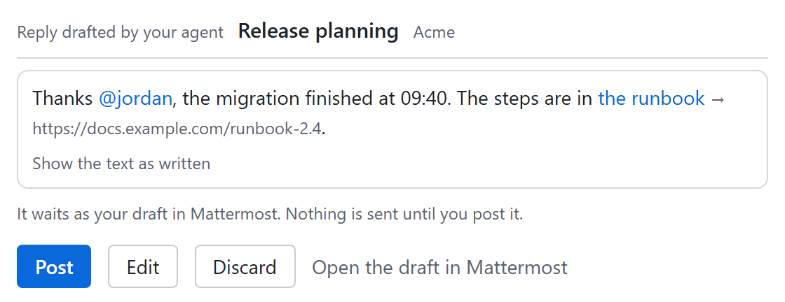
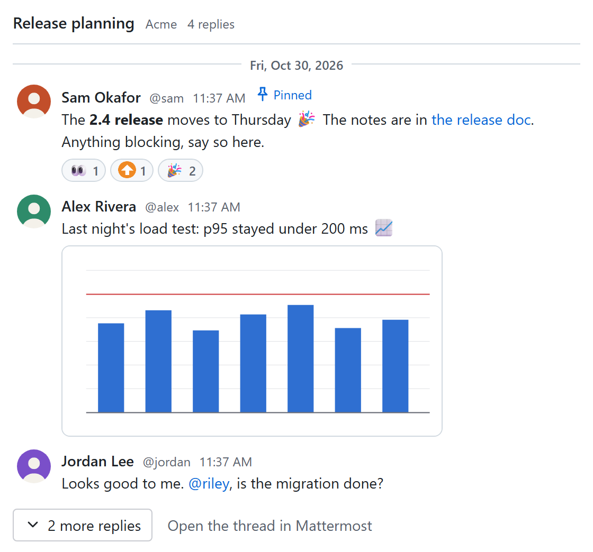

# mm-mcp

[](https://github.com/vriesdemichael/mm-mcp/actions/workflows/ci.yml)
[](https://codecov.io/gh/vriesdemichael/mm-mcp)

An MCP server for Mattermost. It lets an AI agent read and search your Mattermost
and, when you allow it, post and reply, as you or as a bot.

mm-mcp is an independent project. It is not affiliated with, endorsed by or
supported by Mattermost, Inc.; Mattermost is a trademark of Mattermost, Inc.

The tools read channels, threads, unread posts, mentions and files, search
posts, files, people and channels, and, once you allow writes, post, reply,
edit, react, pin, propose posts, join, leave and create channels, and set your
status. A link pasted from Mattermost works wherever a tool that reads wants an
id, every answer links each post, channel and team it names and gives the
address a write others see takes, and attached files, their previews, profile
pictures and custom emoji are MCP resources your client can read too. The
[tools page](docs/site/tools.md) lists every tool. In a client that renders MCP
Apps views, a thread, what is unread for you, or a post your agent made or
proposes can be shown in the chat as Mattermost lays it out; more views are
planned, and the [issues](https://github.com/vriesdemichael/mm-mcp/issues) are
the plan.

A reply your agent drafted, waiting for you to post, change or discard, and a
thread you asked to see, as an AI app that shows views shows them
([try them live](https://vriesdemichael.github.io/mm-mcp/views/)):

<p>
<picture>
  <source media="(prefers-color-scheme: dark)" srcset="docs/site/assets/views/pictures/proposal-dark.png">
  
</picture>
</p>
<p>
<picture>
  <source media="(prefers-color-scheme: dark)" srcset="docs/site/assets/views/pictures/thread-dark.png">
  
</picture>
</p>

## Why it works the way it does

- **Read-only unless you say otherwise.** The tools that post or change anything
  are not offered until `MM_MCP_ALLOW_WRITES` is true. Then your MCP client's
  own approval of each call decides, and mm-mcp checks what each change others
  see states before it acts: how many people a post or an edit reaches and a
  post notifies, the text an edit replaces, what a deletion takes away, and
  where it goes, by address. By default, every post and edit is marked as
  written with AI. `MM_MCP_ELICITATION_OPT_IN=true` has mm-mcp ask you as well,
  in a client that shows its question.
- **Your token, a bot's, or your own login.** A personal access token, a bot
  token, or your own login through `mm-mcp login`, single sign-on included,
  kept in your system's credential store, for servers where
  personal access tokens are switched off.
- **Mattermost's own client.** Requests and answers use the server's own Go
  client and types, not a hand-written description of the API.
- **Every supported release, tested.** Every tool runs against a real Mattermost
  Team Edition, on the Extended Support Release and the newest release on every
  change, and on every release between them each week.
- **stdio and Streamable HTTP.** A client starts it as a local process, or it
  serves Streamable HTTP on a loopback address.

## Quick start

Install mm-mcp with `brew install vriesdemichael/tap/mm-mcp`,
`winget install vriesdemichael.mm-mcp` or
`scoop install vriesdemichael/mm-mcp` (after
`scoop bucket add vriesdemichael https://github.com/vriesdemichael/scoop`), or
download the binary for your machine from the
[latest release](https://github.com/vriesdemichael/mm-mcp/releases/latest).
A [container image](https://vriesdemichael.github.io/mm-mcp/installation/#container-image),
`ghcr.io/vriesdemichael/mm-mcp`, serves the clients that run servers in one.
Then get a personal access token in Mattermost under **Profile → Security →
Personal Access Tokens**, and keep it in your system's credential store, out of
your client's configuration, with
`mm-mcp login --with paste --url https://chat.example.com`. Where those tokens
are switched off, log in once with `mm-mcp login --url https://chat.example.com`
instead.

```json
{
  "mcpServers": {
    "mattermost": {
      "command": "mm-mcp",
      "args": ["serve"],
      "env": {
        "MM_URL": "https://chat.example.com"
      }
    }
  }
}
```

Or, for Claude Code, the plugin, which asks for the address and a token you can
leave empty after `mm-mcp login`:

```text
/plugin marketplace add vriesdemichael/mm-mcp
/plugin install mm-mcp@mm-mcp
```

or the server alone:

```bash
claude mcp add mattermost --scope user --env MM_URL=https://chat.example.com -- mm-mcp serve
```

Claude Desktop users can open the `.mcpb` bundle for their machine from the
latest release instead.

When it does not work, `mm-mcp doctor --url https://chat.example.com` checks
the configuration, the stored login, the way to the server and the credential,
and says what to fix; from inside your MCP client, the `diagnose` tool does the
same with the client's own configuration.

The [documentation](https://vriesdemichael.github.io/mm-mcp/) has every
setting, the tools, and the supported Mattermost releases.

## Contributing

See [CONTRIBUTING.md](CONTRIBUTING.md). The decisions behind how this project is
built are in [docs/site/adr](docs/site/adr/index.md).

## License

[Apache-2.0](LICENSE)
