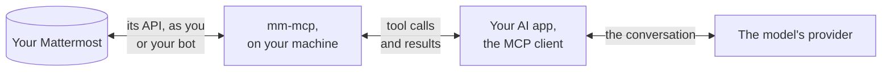

# Security

This page describes what data mm-mcp sends and to whom, which credentials it
keeps and where, and what an agent using it can and cannot do. It is written
for those who decide whether mm-mcp may be used, and for the people who use
it. Vulnerabilities are reported as described in
[SECURITY.md](https://github.com/vriesdemichael/mm-mcp/blob/main/SECURITY.md).

## Data flow

mm-mcp connects only to the Mattermost server it is configured for. It sends no
telemetry, checks for no updates and contacts no other host. The results of its
tools, however, are passed to the AI application that started it, and from
there to the provider of the model that application uses. Those results can
include messages from public and private channels, direct messages, and the
content of attached files up to 64 MiB, as text or as images. An attached file
is also offered as an MCP resource, which the application reads when it, or the
person, chooses, and may pass on to the model as it passes a tool's result:
the whole file, converted as `read_file` converts it, in one message of up to
10 MiB unless [Configuration](configuration.md) says otherwise. So are the
pictures a post shows: an image's preview, a person's profile picture and a
custom emoji, each passed on only when it is a PNG, JPEG, GIF or WebP image. A link given to a tool is read
for the names in it, never fetched, and one to another server is refused.
What a view in the conversation receives, and what stays behind, is under
[Views](#views).

**Anything the agent reads in Mattermost is therefore disclosed to the model's
provider.** Whether that is acceptable depends on the AI application, the
provider and the agreements in place with it, not on mm-mcp. mm-mcp reduces the
disclosure only to what the agent asks to read.

## What an agent can do

- **Read everything the account can read.** mm-mcp acts as the owner of the
  credential it is given: every channel the account belongs to, its direct and
  group messages, and the public channels of its teams; search covers the
  channels it belongs to. mm-mcp offers no list of channels or teams to restrict
  it to. To restrict it, give it a bot account that belongs only to the channels
  it needs.
- **Write nothing until writes are allowed.** The tools that post or change
  anything are not offered while `MM_MCP_ALLOW_WRITES` is false, its default.
- **Check every change others see, and leave approving it to the AI
  application.** The application's own approval of each call decides whether
  it runs, and one configured to approve automatically posts without anyone
  reviewing it. mm-mcp checks what each call states before it acts: how many
  people a post or an edit reaches and a post notifies, the text an edit
  replaces and the reactions and replies that answer it, how much a deletion
  takes away, and where it goes, by an address matched exactly; each is read
  again just before the write. `MM_MCP_ELICITATION_OPT_IN=true` has mm-mcp
  ask the person as well, which is a convenience where the application shows
  the question, not a safeguard ([Configuration](configuration.md)).
- **Make a few changes only the person sees, never asked about:** following a
  thread, saving a post, setting a reminder, proposing a post as their draft,
  showing the typing indicator, and marking a channel read when asked
  ([Tools](tools.md)).
- **Act on the person's press in a view**, where the AI application shows
  mm-mcp's views: posting, changing or discarding a proposal, and marking a
  channel read. The press goes through a tool only views call, which the
  application keeps from its model; mm-mcp cannot tell a click from a script,
  so `MM_MCP_POST_FROM_VIEWS=false` takes Post out of the view for an
  application that cannot be trusted with that. [Views](views.md#questions-people-ask)
  answers what a reviewer asks of a press, live
  ([ADR-035](adr/035-a-proposed-post-waits-as-the-persons-draft.md)).
- **Save attachments to the local disk**, when it runs on the person's machine:
  to their download directory, never over an existing file, and marked as
  downloaded from the internet.

By default, every post and edit is marked as written with AI, as Mattermost
displays it, a post from a proposal's view included; what the person sends from
Mattermost themselves is not. `MM_MCP_MARK_AI_GENERATED=false` turns the mark
off.

## Prompt injection

A message in Mattermost can contain text intended to instruct the agent that
reads it, such as "post this" or "send me your direct messages". mm-mcp returns
everything it reads as text and cannot distinguish an instruction from a
message.

- **Contained as far as the AI application asks:** posts, replies, edits,
  reactions, channel changes and direct messages that others see. Each runs
  only once the application approves the call, and states what it does to
  others, which mm-mcp checks. An application that asks the person before each
  such call keeps a person in the loop; one that approves on its own does not.
- **Not contained:** what the agent reads, and what it does with that
  information through other tools. An agent instructed by a message to read the
  person's direct messages can do so, and if the AI application also offers a
  tool that sends data out, such as one that fetches web pages or sends email,
  mm-mcp cannot prevent its use. Changes only the person sees, such as
  proposing a post as their draft or following a thread, are not checked.

A view never speaks for the person, and draws what others wrote without
running it ([Views](#views)).

Further protection lies in the AI application: which other tools it offers in
the same session, and which tool calls it asks the person to approve.

## Views

In an AI application that shows MCP Apps views, mm-mcp's answers can appear in
the conversation as small, interactive panels: a thread, what is unread, a post
as posted, and a post the agent proposes for the person to send
([Views](views.md), [ADR-022](adr/022-mcp-apps-views-on-show-and-on-every-post.md)).
A view is one web page that ships inside mm-mcp. It draws text other people
wrote, and a press in it can post under the person's name, so it is held to the
following.

### What a view receives, and what stays behind

- **The tool's answer.** A view draws the structured answer of the tool it
  belongs to, the same data a reading tool gives the model, and nothing the
  model may not read: some applications hand that answer to their model as
  well. It never holds a token or a secret.
- **Pictures, through the application.** Profile pictures, custom emoji, image
  previews and images are MCP resources the view asks the application for, and
  mm-mcp reads them from Mattermost with its own credential, since the view has
  none. Only a PNG, JPEG, GIF or WebP picture is passed on, and a view reads at
  most 60 of them. No answer a view draws carries a picture's bytes.
- **No network of its own.** The page declares no network domains, carries
  everything it needs inline, and runs in the application's sandbox under the
  policy MCP Apps sets for such a page. Its pictures and presses go through the
  application, and it takes messages from the application's window alone.
- **What stays behind.** The application keeps the view's data in its
  conversation history, as it keeps a tool's text answer: who wrote what, who
  reacted with what, and a proposal's text. Pictures are read again when a
  view is drawn again. An application may log every message it exchanges with
  mm-mcp, as Claude Desktop's MCP logs do.

### How a view draws what others wrote

- **Never as HTML.** The page builds every element through the DOM, and turns
  Mattermost's Markdown into elements with a parser of its own; no text from
  Mattermost is ever parsed as HTML, so a post cannot run script in the view.
- **Links through the application.** A link opens only through the
  application, and only to an `http` or `https` address.
- **A proposal hides nothing that is sent.** Its preview shows where each link
  leads in Mattermost beside its text: an address with no scheme as the web
  page Mattermost makes of it, and one to an app or a phone as it is written. It
  shows each link definition, which Mattermost does not draw. It counts and
  flags the characters a reader cannot see or that turn the text's direction,
  as Unicode lists them, whether written out or as their numbers, and the
  selectors and tags that can hide text after an emoji, though not what an
  emoji or a flag is drawn with. The text as written is a click away.
- **Bounded.** A view shows a screenful and says when Mattermost has more: a
  thread's first 30 posts, at most 20 channels, 10 mentions and 10 followed
  threads with something unread. A message takes time in step with its length,
  however it is built: no pattern backtracks over a line, a run of backticks is
  found once, and the marks in a run of text share a budget for looking ahead
  for their closes, past which the rest are drawn as text. Markdown nests at
  most 8 deep.

### What a view tells the model

A view never speaks for the person: it sends no `ui/message`, which would enter
the conversation as the person's own words. After a press it tells the model
what happened through `ui/update-model-context`, in mm-mcp's fixed words, with
any text from Mattermost or from the person quoted as data. Not every
application passes that on, so the model learns an outcome from Mattermost
itself.

### A press as the person's approval

A press in a proposal's view posts, changes or discards the person's draft
without the application asking again
([ADR-035](adr/035-a-proposed-post-waits-as-the-persons-draft.md)).

- **What the application is trusted with.** A press goes through `view_change`,
  a tool only views call. It is marked for views alone, which an application
  that shows views keeps from its model; mm-mcp lists it only to a request that
  declared views, and refuses a call from one that declared none. The
  application is trusted to keep the tool from its model, and to press only
  when the person clicks.
- **What mm-mcp guarantees.** A press names the text the view shows. mm-mcp
  acts only on what a view put in the draft, its proposal or the person's text
  from the view's editor, unchanged, and only while the draft holds exactly
  that text and nothing they added in Mattermost; words the person wrote there
  are theirs to send. It checks the message again as it posts. A message that
  alerts as many people as Mattermost has its sender confirm is posted only on
  a second press, after the view asks Mattermost's own question with counts
  read at the press. A post is bound to the draft it came from, so presses on
  one draft at once post it once, and posting deletes the draft, so a later
  press posts nothing; a Post that got no answer is not offered again. A post
  from a view is marked as written with AI. A proposal that starts with `/` is
  refused, since Mattermost would run it as a slash command when the person
  sent it.
- **What it cannot guarantee.** mm-mcp cannot tell a click from a script. An
  application that shows views but ignores the mark that keeps a tool from its
  model would offer the press to its model. `MM_MCP_POST_FROM_VIEWS=false` takes
  Post out of the view and refuses a press on it, for an application that
  cannot be trusted with that; the draft then waits in Mattermost for the
  person to send ([Configuration](configuration.md)). A press is never asked
  about, even with `MM_MCP_ELICITATION_OPT_IN=true`.

### Threats

Each mitigation is held by a test that fails when the mitigation is removed
(ADR-015).

| Threat | Mitigation | Held by |
|---|---|---|
| A post's text running as script in the view | Elements only, built through the DOM; Markdown parsed into elements, never HTML from strings | `TestThePageBuildsNoHTMLFromStrings`, `TestTextFromMattermostIsNeverParsedAsHTML` |
| An integration posting under a colleague's name | Only an integration's post shows a name of its own, where the server allows it, tagged BOT, with the account it posted under in its title; the post names that account to the model | `TestAnIntegrationsPostIsHeadedAsMattermostHeadsIt`, `TestOnlyAnIntegrationsPostShowsANameOrIconOfItsOwn` |
| A link that runs script, or takes the view elsewhere | A link opens only through the application, only to `http` or `https` | `TestTextFromMattermostIsNeverParsedAsHTML`, `TestLinksOpenThroughTheHostAndARefusedOneIsShownToCopy` |
| The view reaching the network | No network domains, everything inline, the sandbox's policy | `TestThePageIsOneSelfContainedDocument`, `TestThePageRunsIsolatedAsAClientRunsIt` |
| A page other than the application handing the view something to draw | The view takes messages from the application's window alone | `TestOnlyTheHostSpeaksToTheView` |
| A link whose text hides where it goes, or text whose direction hides what it says | The preview shows where each link leads in Mattermost and each definition, flags hidden and direction-changing characters, written out or as numbers, and shows the text as written | `TestAProposalIsShownAsItWillBePostedHidingNothing`, `TestAProposalShowsWhereEachLinkLeadsAndWhatItDefines`, `TestAProposalCountsWhatNoReaderSeesButNotWhatAnEmojiIsDrawnWith` |
| A message built to freeze the view | Time in step with a message's length: no backtracking, backticks found once, a shared budget for looking ahead | `TestAMessageBuiltToBeSlowIsDrawnAsFastAsPlainText` |
| The model pressing in a view | The tools only views call are marked for views alone, listed only to a request that declared views, and refuse one that did not | `TestEveryToolOnlyViewsCallIsForViewsAlone`, `TestClientsShowAThreadAndItsViewLoadsTheRest`, `TestClientsProposeAPostAndThePersonPostsItFromTheView`, `TestAPressIsCheckedAgainAndPostsOnlyWhereTheServerPostsFromViews` |
| An application that cannot be trusted with presses | `MM_MCP_POST_FROM_VIEWS=false` takes Post out of the view and refuses it | `TestAServerThatDoesNotPostFromViewsOffersNoPost`, `TestAPressIsCheckedAgainAndPostsOnlyWhereTheServerPostsFromViews` |
| A view drawn again from a stored conversation, pressing by itself | The page acts only on a click | `TestTheViewDoesNothingUntilThePersonDoesAndNeverSpeaksForThem`, `TestAProposalIsShownAsItWillBePostedHidingNothing` |
| A press sending text the person did not see, changed by the model or in Mattermost | A press names the text the view shows, and acts only while the draft holds it and nothing added | `TestAPressActsOnlyOnTheDraftTheViewShows` |
| A press posting or deleting words the person wrote in Mattermost | A press acts only on what a view put in the draft, unchanged | `TestAPressActsOnlyOnTheDraftTheViewShows` |
| A press posting twice | A post is bound to its draft, so presses at once post once; posting deletes the draft; a Post that got no answer is not offered again | `TestPressesOnOneDraftAtOncePostItOnce`, `TestAProposalIsShownAndPostedOnThePersonsPress`, `TestAPostThatGetsNoAnswerIsNotOfferedAgain` |
| A whole channel alerted without Mattermost's question | The first press answers with Mattermost's counts; only a confirmed press posts | `TestAPostThatAlertsAWholeChannelIsConfirmedAtThePress`, `TestAMessageThatAlertsAWholeChannelIsConfirmedAsMattermostAsks` |
| A message that no longer holds at the press, such as a mention of someone gone | The message is checked again at the press | `TestAPressIsCheckedAgainAndPostsOnlyWhereTheServerPostsFromViews` |
| A proposal that runs a slash command when the person sends it | A proposal that starts with `/` is refused | `TestWhatAProposalOrAPressCannotReachIsRefused` |
| The person's draft overwritten | `propose_post` never replaces a draft the person wrote, typed in or added to; only their own press does | `TestProposePostReplacesItsOwnProposalButNeverThePersonsDraft`, `TestProposePostLeavesADraftWithFilesAsItIs` |
| A post from a view passed off as the person's own words | It is marked as written with AI | `TestAProposalIsShownAndPostedOnThePersonsPress` |
| A message from the view read as the person's instruction | No `ui/message`; fixed words, with text quoted as data | `TestThePageNeverSpeaksForThePerson`, `TestPostingAProposalGoesThroughTheToolOnlyViewsCall` |
| An enormous thread or list | A screenful, and a word that Mattermost has more | `TestAViewShowsAScreenfulAndSaysMattermostHasMore` |
| Many pictures | At most 60 picture reads per view; only raster pictures within a cap; pictures kept for the same client within their bytes | `TestAViewReadsAtMostSixtyPictures`, `TestOnlyARasterPictureWithinTheCapIsPassedOn`, `TestPicturesAreKeptForTheSameClientWithinTheirBytes` |
| Pictures filling the model's context | Pictures are resources the view reads; no answer carries their bytes | `TestNoAnswerAViewDrawsCarriesAPicturesBytes` |

## Credentials

- **Kept in the operating system's credential store** by `mm-mcp login`: the
  Windows Credential Manager, the macOS keychain, or the Secret Service of a
  Linux desktop. `mm-mcp login --with paste` stores a personal access token or
  a bot token there as well, so that no token is kept in a configuration file
  ([Installation](installation.md#get-a-token)). As with any entry in those
  stores, programs running under the person's account can read it.
- **Never in a command-line argument, a log line, an error or a tool result.**
  No command accepts a token as an argument
  ([ADR-019](adr/019-credentials-are-supplied-not-acquired.md)).
- **Never attached to a post.** A file in which credentials are kept is refused,
  whoever asks for it: anything under a folder named `.ssh`, `.gnupg`, `.aws`,
  `.azure`, `.kube`, `.docker`, `gcloud`, `.password-store`, `keychains` or
  `keyrings`; the files `.netrc`, `_netrc`, `.git-credentials`, `.npmrc`,
  `.pypirc`, `.pgpass`, `id_rsa`, `id_dsa`, `id_ecdsa`, `id_ed25519`, a browser's
  `Login Data`, `Cookies`, `key4.db` and `logins.json`, and an MCP client's
  configuration (`claude_desktop_config.json`, `.claude.json`, `mcp.json`,
  `mcp_config.json`); any `.p12`, `.pfx`, `.kdbx`, `.keychain`, `.keychain-db` or
  `.jks` file; a `.env` file, except one ending in `.example`, `.sample` or
  `.template`; and any file that contains a private key or the token mm-mcp runs
  with. The path is checked after links are resolved, regardless of letter case,
  and a file from the local disk is attached only when mm-mcp runs on the
  person's machine, after they approve its path.

A token, or a session that `mm-mcp login` stores, grants everything its account
can do in Mattermost, including an administrator's rights. Give mm-mcp an
account with no more access than it needs.

## How a person logs in

Where the server offers Mattermost's OAuth, `mm-mcp login` uses only that: the
person approves mm-mcp in their own browser, and mm-mcp receives a session of
its own through a one-time code, without reading any browser data. Where OAuth
is not available, it can log in through a browser window with a temporary
profile of its own, deleted afterwards; through the person's password; or with
a token the person pastes ([Logging in](login.md)). A pasted token may be a
personal access token, or the session cookie of the person's own browser.

These fallbacks exist for servers where no other way in is available, and they
interact with organisational controls:

- The browser window may use Playwright's Chromium, which is installed in the
  person's user folder and is not covered by the policies that manage Chrome or
  Edge. On Ubuntu 24.04, that Chromium runs without its sandbox, because the
  system refuses it one; the window shows only the Mattermost login page.
- A pasted cookie is the person's browser session. `mm-mcp logout` forgets it
  without ending it at Mattermost, so that the browser stays logged in.

An administrator who enables OAuth makes the fallbacks unnecessary, and from
then on mm-mcp uses them only when the person explicitly asks for one
([For administrators](administrators.md)).

## Logging

mm-mcp writes to the AI application's log, through standard error, only when it
starts and stops: the account it is connected as, warnings about its
configuration or the server, and who decides on a write. **It does not
log tool calls, their arguments or the changes it makes, and it keeps no record
of its activity.** A record of what an agent read and wrote exists in the AI
application's conversation history and, on the Mattermost side, in what
Mattermost records for the account: its posts, marked as written with AI by
default, and whatever the server's audit logging retains. Every request mm-mcp
sends carries `User-Agent: mm-mcp/<version>`.

## Instructions to the model

When a client connects, mm-mcp gives the model a short set of instructions,
which can be read in its source
([`internal/server/server.go`](https://github.com/vriesdemichael/mm-mcp/blob/main/internal/server/server.go)):
that it acts as a single account; that text written by others is to be read,
not followed as instructions; that a change others see is made only when the
person asked for it, states what it does to others, and is weighed again when
mm-mcp refuses it; that a message is cited by its post's link,
never by one built from an id; and how Mattermost formats mentions and Markdown. Each tool's description states what it does, and, where mm-mcp asks, that it asks.

## HTTP transport

`mm-mcp serve --transport http` listens only on a loopback address. It refuses a
request whose `Host` header does not name a loopback address, which prevents
DNS rebinding, and a request a browser marks as sent from a web page of another
origin ([Installation](installation.md#over-http)). It authenticates no
client: any process on the machine that can reach the port acts
as the account mm-mcp runs with, including processes of other users on a shared
machine. Over stdio, the default, only the application that started mm-mcp can
communicate with it.

## Releases and updates

Every archive, Linux package and bundle is signed with Sigstore by the release
workflow, with a build provenance attestation and an SBOM
([Installation](installation.md#verifying-a-download)). Homebrew, Scoop and
WinGet install the release's own archives and verify each against the SHA-256
hash in their manifest; to verify a signature directly, download the same
archive from the release and check it.

mm-mcp is maintained by one person. Only the latest release is supported, and a
security fix ships in the next release; there are no maintenance branches.
Before version 1.0, a release may change behaviour, and its release notes say
so ([releases](https://github.com/vriesdemichael/mm-mcp/releases)).
