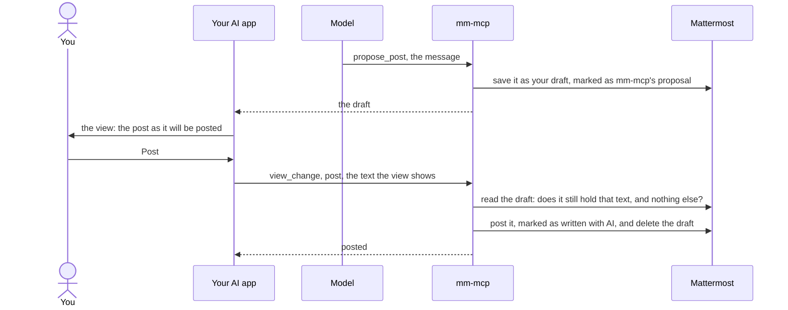

# Views

In an AI app that shows MCP Apps views, mm-mcp puts what you asked to see in
the chat as Mattermost lays it out: a thread, or what is unread for you. Every
post your agent makes shows itself there as posted, and a post it proposes
waits there for you to post, change or discard
([ADR-022](adr/022-mcp-apps-views-on-show-and-on-every-post.md)).

The views on this page are the real page mm-mcp serves, run here as an AI app
runs it, sandboxed and reaching no network, with what it drew on a Mattermost
of ours. Press anything: nothing leaves this page, and
**Start over** under a view puts it back as it was.

## A post for you to send

Ask your agent to draft something for you to check, and it proposes it with
[`propose_post`](tools.md#propose_post). The proposal waits as your draft in
Mattermost, and the view shows it as it will be posted, with where it goes,
what its mentions do, and Post, Edit and Discard
([ADR-035](adr/035-a-proposed-post-waits-as-the-persons-draft.md)).

Your agent, with mm-mcp

Jordan asks whether the migration is done. Draft a reply for me to check.

propose_post, in reply to Sam's thread in ~release-planning

A link shows where it leads where its text says something else. Post sends the
draft as the view shows it, marked as written with AI, and Edit saves what you
change into your draft, which is then yours. Each press acts only while your
draft still holds what the view shows: typed on in Mattermost meanwhile, the
view draws it again as it is now.

A message that alerts the whole channel is confirmed first, as Mattermost asks
before `@channel`, `@all` or `@here` reaches more than five people, in its own
words and with its own counts:

## A thread

[`show`](tools.md#show) with kind `thread` shows a post and its thread: who
wrote each post, with their picture, the Markdown drawn, reactions, a custom
emoji among them, and images you open whole. The rest of a long thread loads
as you ask.

## What is unread

[`show`](tools.md#show) with kind `unreads` shows your channels with something
unread, by team, the posts that mention you, and the threads you follow with
unread replies. A channel's unread messages open in place, and once writes are
allowed, Mark read marks it read in Mattermost.

## A post as posted

Every post your agent makes with [`create_post`](tools.md#create_post),
[`dm`](tools.md#dm) or [`group_message`](tools.md#group_message) shows itself
in the chat as posted, under where it went: posting in many places is as loud
for you as for the people it reaches.

## When you already have a draft there

Mattermost keeps one draft in each channel and in each thread. Where your
agent proposes a post:

- **Nothing is there, or mm-mcp's own proposal, unchanged:** the proposal is
  saved, as above.
- **A draft of yours, which you asked your agent to improve:** nothing is
  written. The view shows the proposal as a revision of your draft, word by
  word, with Apply and Keep mine.
- **A draft of yours, otherwise:** nothing is written. The view shows yours
  beside the proposal, with Replace mine and Keep mine.

## In an app without views

Every app still works. A proposal waits in your message box in every
Mattermost app, and the answer links the place where it waits. Your agent
reads what you did from Mattermost: the draft gone, or the post in the
channel.

~release-planning

<strong>Sam Okafor</strong> The 2.4 release moves to Thursday. Anything blocking, say so here.

Thanks @jordan, the migration finished at 09:40. The steps are in [the runbook](https://docs.example.com/runbook-2.4).Send

Draft

[`show`](tools.md#show) in such an app says nothing was shown, and your agent
answers in words.

## Where views work

| App | Views | What to know |
|---|---|---|
| Goose's desktop app | Yes | Its approve and smart approve modes refuse every call a view makes: the views draw, and a press says it cannot act there and offers the place in Mattermost. |
| VS Code | With `chat.mcp.apps.enabled` on | It asks before `propose_post`, as before any write; a press in a view is yours and is not asked about. |
| Claude desktop, Claude on the web | Checked by hand | They cannot be driven by a machine. What a person found is recorded on [mm-mcp#37](https://github.com/vriesdemichael/mm-mcp/issues/37). |
| An app without MCP Apps | Text | `show` says nothing was shown, and a proposal waits in Mattermost. |

Goose and VS Code run every view on every change to mm-mcp, at the versions the
repository pins ([ADR-036](adr/036-real-clients-run-the-views-at-pinned-versions-with-a-scripted-model.md)).
`diagnose` tells you whether your app shows views.

## Why a press is safe

A press in a view posts, changes or discards a draft without your app asking
you again. What stands between a model and a post:

- **Only a view presses.** A press goes through `view_change`, a tool for views
  alone: an app that shows views keeps it from its model, and mm-mcp offers it
  only to an app that says it shows views, once writes are allowed.
- **A press names what you saw.** mm-mcp posts only while your draft holds the
  text the view shows, and nothing you added in Mattermost; a second press finds
  nothing to post.
- **Mattermost's question comes first**, for a message that alerts more than
  five people, counted when you press.
- **The preview hides nothing that is sent.** A link shows where it leads, a
  character you cannot see or that turns the text's direction is flagged, and
  the text as written is one click away. Here, a right-to-left override in
  `invoice_fdp.exe` makes it read as `invoice_exe.pdf`:

- **The setting.** mm-mcp cannot tell a click from a script, so
  `MM_MCP_POST_FROM_VIEWS=false` takes Post out of the view, for an app that
  cannot be trusted to keep the view's tool from its model, or to press only
  when you click; the draft then waits in Mattermost for you to send
  ([Configuration](configuration.md)).
